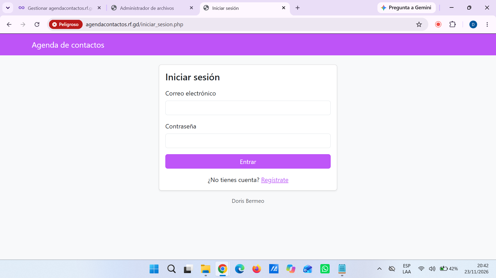
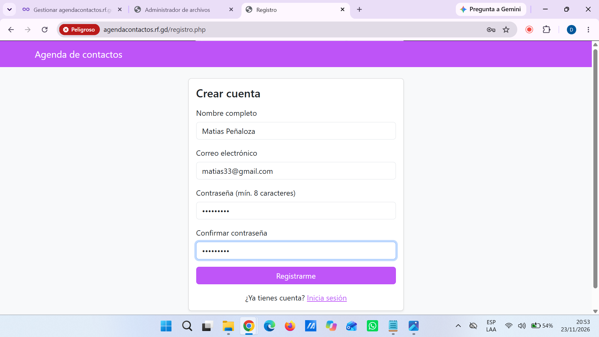
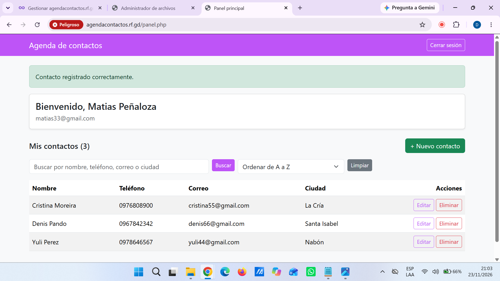
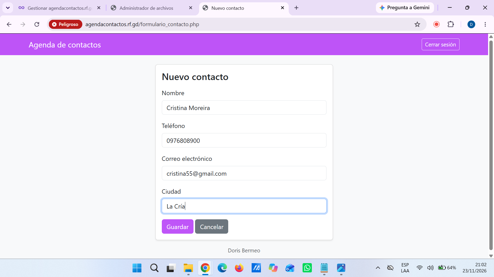
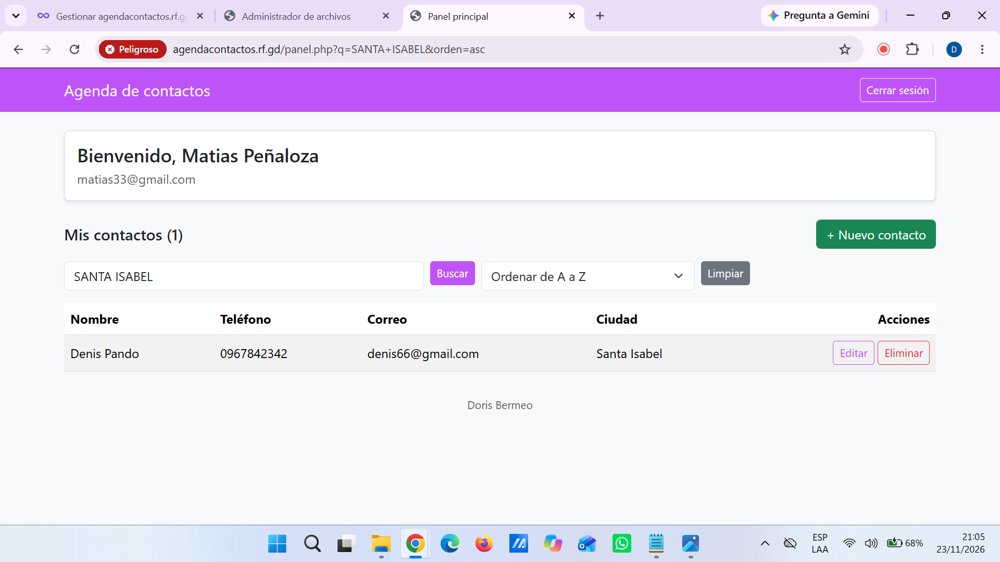
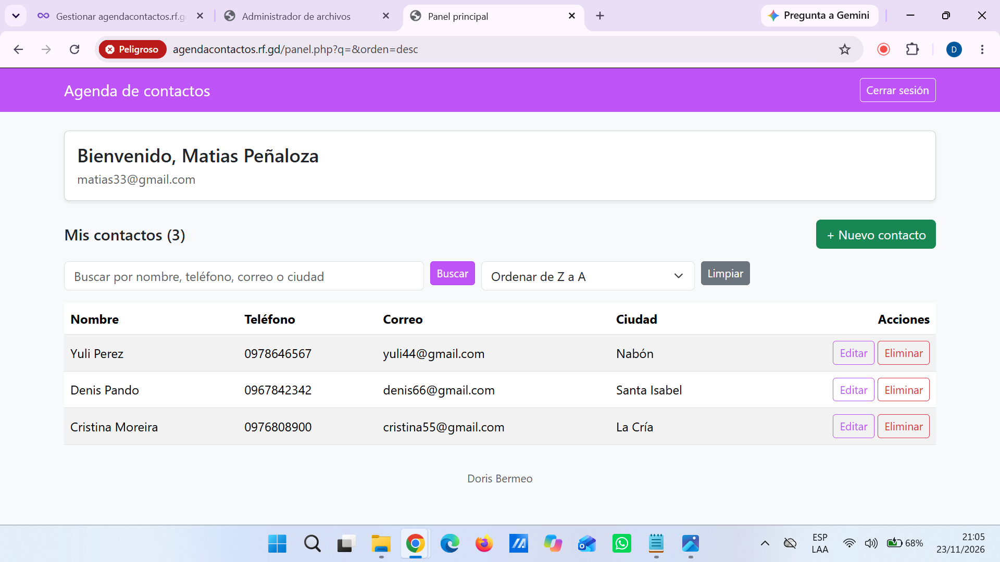

# Agenda de contactos (PHP + MySQL)
Doris Nathaly Bermeo Bermeo

Desarrollo Web

## Descripción
Aplicación web donde cada usuario se registra, inicia sesión y administra su propia
lista de contactos (registrar, editar y eliminar con confirmación). Un usuario nunca puede
ver, editar ni eliminar contactos de otro usuario, aunque modifique manualmente la URL.

Ejecución de 2 mejoras en nuestra aplicación web.
1. Busqueda de los contactos ya sea por: Nombre, Teléfono, Correo o Ciudad. 
2. Ordenamiento de toDos los contactos de la (A-Z) o tambien de la (Z-A)
## Capturas de pantalla







## Tecnologías utilizadas
- PHP 8.1+ (PDO, sesiones)
- MySQL / MariaDB en Xampp
- HTML5 y Bootstrap 5 (CDN)

## Seguridad implementada
- `password_hash()` y `password_verify()` para las contraseñas.
- Validación de formularios en el servidor.
- Verificación de sesión activa en todas las páginas protegidas (`exigir_sesion()`).
- Consultas filtradas por el `id_usuario` de la sesión: impide el acceso a contactos ajenos.
- Consultas preparadas (PDO) contra inyección SQL y escape de salida contra XSS.
- Token CSRF en todos los formularios POST; `session_regenerate_id()` al iniciar sesión.
- Mensajes de error genéricos que no revelan información sensible.

## Requisitos
- PHP 8.1 o superior con la extensión `pdo_mysql`
- MySQL 5.7+ o MariaDB 10.3+
- Servidor local: XAMPP, Laragon, WAMP o el servidor embebido de PHP

## Instalación
1. Clona el repositorio o copia la carpeta en `htdocs` (XAMPP) o `www` (Laragon), **dándole el nombre de carpeta `agenda_contactos`**:
2. Importa la base de datos:
   - phpMyAdmin → Importar → `sql/base_de_datos.sql`, o
   - Terminal: `mysql -u root -p < sql/base_de_datos.sql`
3. Edita `config/conexion.php` si tu usuario o contraseña de MySQL son distintos de `root` / vacío.
4. Abre `http://localhost/agenda_contactos/` (o ejecuta `php -S localhost:8000` dentro de la
   carpeta del proyecto y entra a `http://localhost:8000`).
5. Regístrate, inicia sesión y comienza a agregar contactos.

## Estructura
```
agenda_contactos/
├── config/conexion.php         Conexión a la base de datos (PDO)
├── includes/
│   ├── autenticacion.php       Sesión, CSRF y validaciones
│   ├── encabezado.php          Plantilla superior
│   └── pie.php                 Plantilla inferior
├── css/estilos.css
├── sql/base_de_datos.sql       Script de la base de datos
├── index.php                   Redirección según la sesión
├── registro.php                Registro de usuarios
├── iniciar_sesion.php          Inicio de sesión
├── cerrar_sesion.php           Cierre de sesión
├── panel.php                   Panel privado con datos y contactos
├── formulario_contacto.php     Registrar / editar contacto
└── eliminar_contacto.php       Confirmación y eliminación
```
